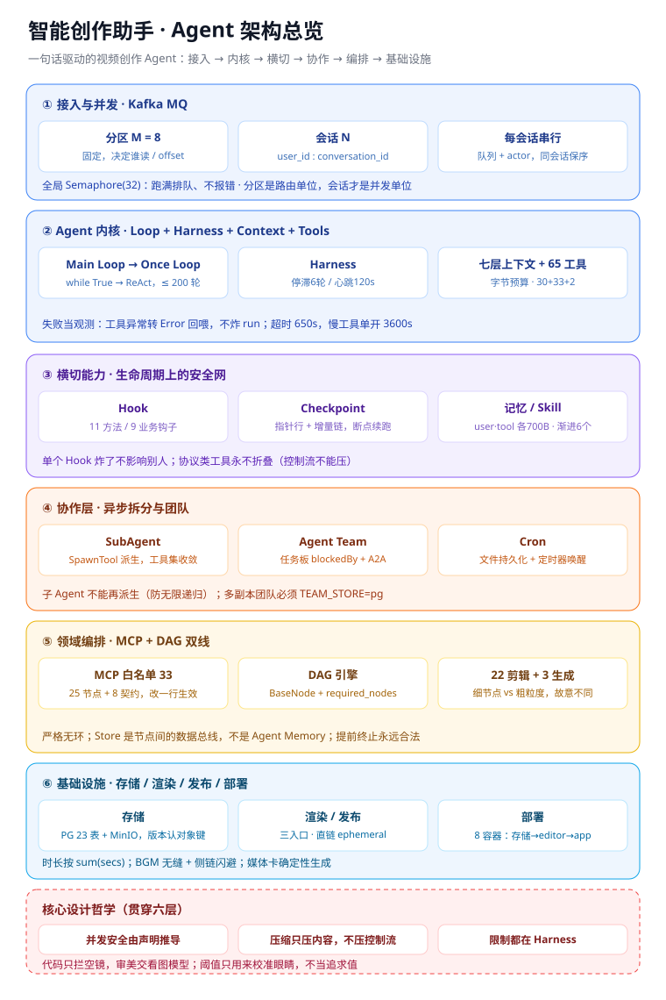

# 智能创作助手（AI Video Editing Assistant）

一句话驱动的视频创作 Agent。给一句选题，它自己分镜、逐镜写画面、配旁白与配乐，一次渲成片；也可以**先看分镜表、改完再渲**。

需求里没提的创作决定——镜数、构图、配色、字幕位置、转场——由 Agent 依选题自己定，过程中不再追问。**唯一该由人拍板的是分镜**：十五句话读下来，对不对十秒就知道；读着不对，就不烧那十几分钟渲染。

---

## 架构总览



**三条贯穿始终的原则**：并发安全由声明推导（不靠模型自觉）；压缩只压内容、不压控制流；代码只拦空镜，审美交看图模型。

---

## 技术栈

**后端**：Python 3.12 · FastAPI · SQLAlchemy(async) + PostgreSQL 16 · MinIO · Kafka · Redis
**Agent**：OpenAI 兼容 SDK · MCP（fastmcp / mcp）· 自研 DAG 编排引擎
**媒体**：ffmpeg · MoviePy · faster-whisper（ASR）· edge-tts
**渲染与前端**：Remotion 4 + React 19 · Vue 3 + Vite
**部署**：Docker Compose · Caddy（反代 / TLS）

---

## 功能

**两条出片通道**

- **素材剪辑**：上传视频/音频（或粘贴链接），自动切分镜头、语音转写、理解画面、筛选分组、撰写文案、配音配乐、编排时间线并渲染。
- **零素材出片**：只给一个选题。画法不预设——镜数、镜长、配色、构图、笔触由导演（一次模型调用）按选题定，画面**逐镜现写 SVG**（实测 15 镜出 15 种画法，不是把同一批组件重排）。

**关键能力**

- **先看分镜再渲**：`POST /simple/plan` 只出分镜，1 次调用、约 10 秒；每句可直接改，确认后才写画面并渲染——分镜错了只花 1 次调用，而不是整条重跑。
- **改一镜**：`reshoot_shot` 只重写第 N 镜并出 2 张静帧，1 次调用；满意了再 `render_short_film` 重渲整片（音轨照用）。
- **字幕三层**：`overlay`（外层统一加）/ `drawn`（默认，模型画进画面）/ `none`。没有底部黑条，靠描边与双层阴影保证可读。
- **卡拍**：点名配乐时先检拍点，把切点往最近拍点吸（只往后补、封顶 0.45 秒）。
- **随时叫停、从一致点续跑**：停止在最近一致性点收手，状态记 `cancelled`，不进崩溃恢复队列；气泡里可「从最新一致点续跑」。
- **逐帧质检 + 三层兜底**：每镜渲 3 帧量内容占比/亮度/饱和，不合格带**具体读数**打回重写（"亮度只有 17/255"而不是"亮一点"）。
- **出处账**：每个数字都要能说清从哪来，缺出处的镜在报告里点名，不假装核实过。
- **工程能力**：崩溃可续跑的执行快照、多用户隔离、模型密钥按用户配置、技能按需加载、MCP 扩展、长期记忆。

---

## 工程亮点

- **自研 DAG 编排引擎**：`BaseNode` + `required_nodes` + 拦截器递归补齐 + `Store` 数据总线，按视频领域定制的工作流引擎（严格无环）。
- **生成线续跑缓存**：每镜定稿即落盘，中断/停止后重来只补未定稿的镜；按请求参数做键、2 小时 TTL、成功清缓存。
- **逐帧质检 + LLM 评审**：像素判据只拦客观空镜，构图/审美交看图模型（帧通道 / 静帧审美 / 身份判据）。
- **规模**：65 工具、25 节点、33 白名单、23 张表、8 容器。
- **崩溃可续跑**：检查点用「指针行 + 增量链」，五状态流转，不重做已完成步骤。
- **失败当观测**：工具异常转 `Error:` 回喂、超时分两档（650s / 慢工具 3600s）、同参去重。
- **MCP 扩展存量服务**：存量 API 通过 MCP 接入，Agent 侧只负责规范 LLM 调用。
- **可验证**：后端约 100 个自检脚本（`python tests/xxx.py`）+ 渲染服务构建期自检。

---

## 快速开始（Docker，推荐）

前置：Docker（含 Compose v2）、内存 16 GB 及以上、一个 OpenAI 兼容接口的模型 API Key（默认对接 DeepSeek）。

```bash
git clone <仓库地址> && cd <仓库目录>
cp .env.example .env                          # 本机使用可直接沿用默认值
docker compose up -d                          # 存储层：PostgreSQL + MinIO + Redis
docker compose --profile app up -d --build    # 应用层：剪辑 + 渲染 + 主服务 + Caddy
```

首次构建约 10~20 分钟。启动后：

1. 打开 <http://localhost> 注册账号；
2. 左下角「设置」填入模型 API Key，保存即生效；
3. 发送需求，例如：
   > 做一条竖屏科普短视频，主题：为什么天空是蓝色的，2 分钟左右，字幕用撕纸高亮。

**验证**：`docker ps` 中 `creation-app` / `creation-editor` / `creation-remotion` 均为 `healthy`，且 `docker logs creation-app` 出现「Storyline 已接入 … 个剪辑节点」。

**改代码**：后端四个目录（`agent_framework/`、`open_storyline/`、`examples/`、`prompts/`）已 bind mount，改完 `docker compose restart app` 几秒生效；前端产物烤在镜像里，改了要重建。

> 全部配置见 `.env.example`（每项有注释）；剪辑能力配置在 `backend/examples/storyline/config.toml`。本机开发与多副本部署的开关，见 `python run_server.py --help`。

---

## 目录

```
backend/
  agent_framework/   Agent 框架：主循环、工具注册与并发、上下文与压缩、技能、记忆、
                     检查点、计划门、HTTP/WS、存储层
  open_storyline/    剪辑服务（MCP）：剪辑节点、零素材出片链（simple/）、渲染调度（motion/）
  prompts/           提示词库（Markdown，改文案不改代码）
  examples/          内置技能 + 剪辑服务配置
  tests/             后端自检脚本（自带 check()，无需 pytest）
  run_server.py      主服务入口（:8000）    run_storyline.py  剪辑服务入口（:8001）
remotion/            Remotion 渲染服务（母版、设计 token、代码检查规则）
frontend/            前端（Vue 3 + Vite）
docs/                架构图等
deploy/Caddyfile     反向代理配置
docker-compose.yml   存储层（默认）+ 应用层（profile: app）
```

---

## 常见问题

| 现象 | 处理 |
|---|---|
| 回复「无剪辑能力」 | 剪辑服务未启动/未连接。本机需先起 :8001 再起 :8000；容器确认 `creation-editor` healthy 后重启 `creation-app` |
| 所有对话 402 / 鉴权失败 | 模型余额不足或密钥错误，在「设置」重填，无需重启 |
| 页面能开但媒体不能播 | `MINIO_PUBLIC_ENDPOINT` 不是浏览器可达地址；改成局域网 IP:9000 并放行 |
| 改代码未生效 | 后端是 bind mount，`docker compose restart app`；前端改了要重建镜像 |
| 零素材出片渲染慢 | CPU 软件渲染约 0.4~0.5 秒/帧，60 秒片子约 15 分钟；可调 `DG_RENDER_SLOTS`（注意内存） |

---

## 许可证

本项目采用 [PolyForm Noncommercial License 1.0.0](LICENSE)，为非商业许可证：

- **允许**：学习、阅读、克隆运行、个人研究、教学、非营利组织内部使用，以及在此基础上修改。
- **禁止**：任何商业用途，包括出售、提供付费服务，或用于以营利为目的的产品与业务。
- **须保留**：版权与许可声明，即 `LICENSE` 顶部的 Required Notice 一行；修改之处需明确标注。

商业授权请联系作者。第三方依赖各依其自身许可证（MIT、Apache-2.0 等），不受本许可证约束。
